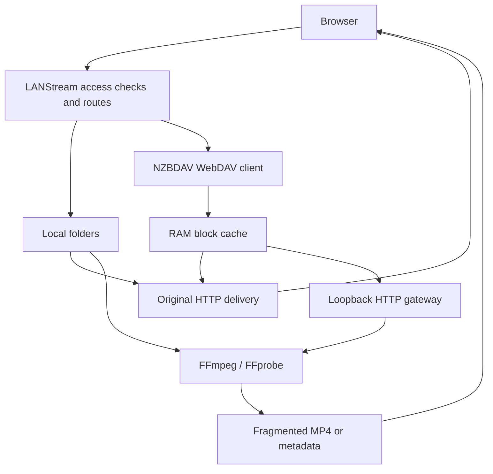

# Architecture and data flow

[Documentation home](../README.md) · [Manual](../manual.md) ·
[Configuration](configuration.md)

This guide describes the current implementation, including memory ownership,
remote reads and the distinction between original delivery and conversion.

## Components

| File/directory | Responsibility |
| --- | --- |
| app.py | Configuration, access checks, folder/viewer routes, backend selection and command construction. |
| launcher.py | Waitress startup and address display. |
| gunicorn.conf.py | Linux/Docker workers, threads and shutdown hooks. |
| media_runtime.py | External-process ownership, timeouts, termination and cleanup. |
| media_cache.py | Bounded FFprobe metadata cache with TTL and concurrent request coalescing. |
| nzbdav.py | WebDAV client, virtual paths, RAM block cache and local gateway. |
| subtitle_windows.py | Bounded packet capture, payload extraction and subtitle-only containers. |
| tone_mapping.py | HDR/base-layer classification, color-filter plans and the tiny HDR capability fixture. |
| templates/ | HTML and initial player data. |
| static/player.js | Playback state, source switching, quality, codecs, seeking and metrics. |
| static/subtitles.js | Subtitle windows, prefetch, cancellation and cue cleanup. |
| tests/ | Python/JavaScript regression checks and optional real media/hardware tests. |

There is no collection database or separate media-indexing service.
FFmpeg/FFprobe are subprocesses created for requested work.

## Main data paths



FFprobe can precede either original delivery or transcoding.
STRM HTTP targets take a separate remote-reading path; the NZBDAV cache does not
automatically cache arbitrary URLs. Native HLS can redirect clients upstream.

## Browsing and authorization

The session gate runs when authentication is enabled.
Each content request determines the current profile's roots, resolves the path
and checks confinement/exclusions, including symbolic-link resolution.

Local folders use scandir and reuse directory-entry metadata.
Configuration parsing and resolved exclusions are reused within a single request.
Only the current directory is listed and naturally sorted; no recursive library
scan or global search index is created.

Image/document thumbnails are queued lazily. Two workers generate derivatives;
new navigation changes the generation to discard obsolete work.
Videos do not trigger thumbnail extraction or folder preview scans.

The first password profile owns Settings and integrated NZBDAV.
Status routes remain server-wide views, rather than per-library content listings.

## Metadata probing

FFprobe returns container, duration, bitrate, color properties and track metadata.
Probing can require reads from different file regions.
Dolby Vision configuration side data is requested so proprietary profiles are not
mistaken for ordinary HDR10 solely from their transfer tag.

MetadataCache stores up to 128 results per process for 300 seconds.
Local keys include the tool, path, file identity, timestamps and size.
Replacement or modification creates a different key.
Concurrent lookups share a pending probe, errors are not cached as valid results,
and callers receive copies.

Access/STRM resolution runs before cache lookup.
Remote STRM URLs are probed without local stat-based caching.
NZBDAV provides virtual stat values from remote resource versions; probe reads
reuse its shared block cache.

Transcoding now obtains source video metadata even when no audio conversion is
selected, so it can choose the correct HDR path.

## Original delivery

Local files are sent without encoding, with HTTP Range support.
NZBDAV originals read through the same RAM blocks as probes/transcoding/subtitles.

Remote STRM delivery forwards source bytes, Range/If-Range and relevant response
headers. Native HLS redirects upstream so playlists, segments and keys resolve
relative to their origin.

Original bypasses conversion, including tone mapping.
Browser decoding/HDR support remains necessary.

## Transcoding

The command is constructed from backend, source, start time, audio stream,
quality, output codecs and source color metadata.
It maps video 0:v:0 and the selected audio stream, or disables audio.

FFmpeg writes fragmented MP4 to stdout.
The response reads its pipe and sends bytes to the browser while a separate thread
drains stderr. There is no persistent encoded output movie.

The GOP setting is 48. Short fragments allow progressive delivery.
Limited presets configure video bitrate/maxrate/buffer; unrestricted profiles use
backend-specific quality controls.
Audio is converted to stereo at 48 kHz.

Playback input arguments omit a redundant seek to zero and disable unnecessary
MPEG-PS/TS end-of-file duration estimates. FFprobe still obtains duration normally.
Nonzero -ss remains before the input for seeking.
Stream discovery is not indiscriminately restricted to reduce latency.

### VAAPI surfaces

A named device is shared by decoder, filters and encoder:

```text
-init_hw_device vaapi=lanstream:/dev/dri/renderD128
-filter_hw_device lanstream
-hwaccel vaapi
-hwaccel_device lanstream
-hwaccel_output_format vaapi
```

For SDR, scale_vaapi resizes/converts GPU surfaces to NV12.
For PQ/HDR10, tonemap_vaapi runs first, followed by scale_vaapi.
Encoders are h264_vaapi, hevc_vaapi or av1_vaapi.

No CPU scale/format, hwupload or hwdownload appears in the playback graph.
Metadata-only setparams/sidedata filters do not download surfaces.
An input decoder producing incompatible CPU frames cannot transparently enter
this GPU-only graph.

Synthetic encoder availability tests are different: lavfi generates raw CPU frames,
which must be uploaded before processing. They test encoding, not every decoder.

### Other backends

QSV/NVENC/AMF use hardware encoders with software decoding and filters.
The software encoders are libx264, libx265 and libsvtav1.
Their HDR processing uses zscale/tonemap on CPU.
Unavailable HEVC/AV1 outputs can fall back to software except on VAAPI.

## HDR classification and SDR output

tone_mapping_plan is based on probe metadata, never the filename or bit depth alone.

| Input | Behavior |
| --- | --- |
| SDR/10-bit SDR | No HDR conversion filters or forced BT.709 tags. |
| PQ/smpte2084 | HDR10-style conversion to SDR. |
| HLG/arib-std-b67 | CPU, libplacebo or OpenCL path; rejected by the default VAAPI mapper. |
| Dolby Vision Profile 7 / compatible Profile 8 | Uses an ordinary HDR10/HLG base layer where supported. |
| Unsupported proprietary Dolby Vision profiles | Rejected rather than treated as ordinary PQ. |

For HDR with missing primaries/matrix, the plan uses BT.2020 base-layer defaults.
Known supported color values are validated before constructing filter strings.
Unsupported values fail instead of being interpolated into arbitrary filter syntax.

VAAPI uses explicit BT.709 output on tonemap_vaapi and limited-range GPU scaling.
Optional tone_mapping=libplacebo-bt2390, libplacebo-mobius and libplacebo-reinhard
derive a Vulkan device from the selected VAAPI device. The graph maps VAAPI
surfaces to Vulkan, applies libplacebo with explicit limited-range BT.709 output,
maps back to VAAPI, then scales/encodes. No hwdownload or software video filter
is inserted. Dolby Vision application is disabled so these modes consistently
use the already classified HDR10/HLG base layer. The cached fixture encode tests
both hardware mappings and the encoder, keyed by backend and mapping mode.
OpenCL alternatives derive an OpenCL device from VAAPI. The graph first converts
decoded surfaces to P010 using scale_vaapi (required by the OpenCL kernel),
maps to OpenCL, applies tonemap_opencl with explicit BT.709/range, and uses
hwmap=derive_device=vaapi:reverse=1 to allocate VAAPI-compatible output surfaces
mapped back to OpenCL for writing. The remaining VAAPI scaling/encoder pipeline
is shared. OpenCL input gamut/matrix restrictions are validated before launch.
Immediately after tone mapping, a metadata-only setparams filter declares the SDR
matrix, transfer, primaries and range to FFmpeg's graph negotiation. This prevents
FFmpeg 8.1 from propagating the input BT.2020 matrix to the encoder and inserting
an incompatible software converter. Automatic conversion filters are disabled for
the HDR VAAPI graph; both the capability test and playback use this same path.
That global FFmpeg option also affects audio. HDR VAAPI playback therefore adds
an explicit aresample filter for stereo downmix, 48 kHz output and the selected
audio encoder's sample format. This includes multichannel/height-channel sources;
audio processing remains on CPU, independently of the GPU video surfaces.
The CPU graph linearizes HDR with zscale, uses floating-point RGB, converts gamut,
applies Hable and re-encodes BT.709 transfer/matrix/range.
The output encoder is tagged BT.709 and stale frame side data is deleted after
conversion. Global source metadata is not blindly copied to the SDR output.

This maps base-layer video, not Dolby Vision RPU/enhancement-layer reconstruction.
Original delivery bypasses the entire plan.

### Capability checks

A cached FFmpeg filter inventory identifies missing filters.
Before HDR streaming, tone_mapping_test decodes/filters/encodes a tiny built-in
HEVC Main 10/PQ frame with mastering-display and content-light SEI.
The compressed fixture, subprocess input and output are all held in memory.

This avoids testing with a user's remote movie and does not require runtime x265.
A failure returns HTTP 503 before opening the playback encoder.
An unsupported source plan returns HTTP 415.

The test is cached per backend and reset by Activity's retest/restart.
It does not certify every source resolution or metadata combination.
In particular tonemap_vaapi expects mastering-display metadata on decoded input;
the source may still fail even when the fixture passes.
See [FFmpeg's implementation](https://github.com/FFmpeg/FFmpeg/blob/master/libavfilter/vf_tonemap_vaapi.c)
for its input/driver requirements.

## NZBDAV block ownership

Each worker owns a WebDAV client and a 4 MiB-block LRU.
Capacity is independent of total open-file size.

1. Build the resource-version/block-index key.
2. Reuse and refresh recency on a hit.
3. Share a pending fetch when another reader requests that block.
4. Reserve capacity before starting a new fetch.
5. Evict eligible least recently used blocks when needed.
6. Publish the fetched range and wake waiting readers.

Reservations count before bytes arrive. Errors release reservations.
There is no whole-movie predownload.

A block lease is held only while copying a small portion.
The network response receives a copy of at most 64 KiB, then the lease is released
before waiting on the browser. A stalled connection does not pin a complete block
for the lifetime of an open movie.

Remote metadata is reused for approximately ten seconds, up to 512 resources.
Version information participates in block identity.
Without reliable validators, metadata refresh changes the generation rather than
reusing bytes indefinitely based only on path/size.

The HTTP client limits concurrent backend connections to eight, reuses TCP/TLS
and cookies, and retries a stale persistent connection once before body delivery.
It follows neither redirects nor environment proxies.
Listings have bounded reads and unsupported XML constructs are rejected.
Ignored/inconsistent media ranges cause errors rather than unbounded downloads.

The gateway binds to loopback on an ephemeral port, maintains a bounded token
registry and serves FFmpeg/FFprobe from the shared cache.
It is not a public authentication endpoint or a port to expose.

## Subtitle windows

The browser requests 20-second windows with a 15-second stride.
Overlaps permit prefetch; obsolete results are ignored after cancellation.

Server packet discovery uses timestamps across streams to bound silent gaps.
Common Matroska blocks are validated before byte-offset reads.
MOV_TEXT samples use packet offsets.
Compressed/laced/unusual cases can use bounded packet capture.

Only subtitle payloads are repackaged into a small in-memory Matroska and passed
to FFmpeg on stdin for WebVTT. The conversion does not reopen the full film.
Browser cue times are normalized onto the source timeline after a transcoding seek.
Changing subtitles does not restart video.

Requests have deadlines; HTTP 504 triggers a delayed retry.
Long cue end times are retained where known and old cues are removed.

## Metrics, workers and shutdown

Byte counters are updated during delivery.
Playback info binds metrics to browser session, source and request ID.
Completed request statistics can remain for ten minutes, up to 128 recent entries,
while the browser plays buffered data.

Activity uses the process-wide active-request view.
Polling does not run FFprobe again every second.
A completed response is not the same as completed playback.

The supplied Gunicorn configuration uses one worker and eight threads.
Additional workers multiply RAM budgets and split cache/metrics/gateway state.
There is no distributed coordinator. A shared cookie secret does not share caches.

Graphics derivatives are written to temporary files in their cache directory,
then atomically renamed. That cache has no block-LRU storage budget.

MediaRuntime owns external processes, enforces command timeouts and reaps children.
At worker shutdown it signals children, closes registered services/connections,
then kills remaining processes within the cleanup budget.
Gunicorn hooks initiate this on SIGTERM.
Streams are interrupted; this is not seamless rolling playback migration.

## Main routes

Content indices refer to roots in the current profile, not universal media IDs.

| Route | Purpose |
| --- | --- |
| / | Libraries. |
| /login, /logout | Session access. |
| /settings | Administrative configuration read/save. |
| /browse/&lt;index&gt;/&lt;path&gt; | Current folder. |
| /video/&lt;index&gt;/&lt;path&gt; | Video details. |
| /play/&lt;index&gt;/&lt;path&gt; | Player. |
| /media/&lt;index&gt;/&lt;path&gt; | Original bytes/STRM relay. |
| /transcode/&lt;index&gt;/&lt;path&gt; | Live fragmented MP4 output. |
| /subtitle/&lt;index&gt;/&lt;path&gt; | WebVTT window. |
| /image/, /image-file/ | Image viewer/data. |
| /document/, /document-page/ | Document viewer/page images. |
| /text/ | Plain-text viewer. |
| /thumb/, /api/image-ready/ | Derivatives and readiness. |
| /api/image-navigation/ | Fullscreen image navigation data. |
| /transcoder-status | Activity page. |
| /api/transcoder-status | Global status; refresh=1 repeats backend tests and clears capability caches. |
| /api/transcode-codecs | Output codec availability/backend choices. |
| /api/playback-info/&lt;index&gt;/&lt;path&gt; | Current player request metrics, including tone mapping. |
| /hw-status, /qsv-status | Historical JSON status aliases. |

Abbreviated content prefixes also require index/path.
These are interface endpoints, not a versioned integration API.
When authentication is enabled, unauthenticated API requests can redirect to login
instead of returning JSON.

Subtitle arguments include stream, start, optional duration (5–30, default 20)
and absolute (0/1). The player manages timeline correspondence.
Transcoding arguments include start, audio, quality, codecs and playback_id.

## Developer verification

Install the relevant requirements, FFmpeg tools and Node.js for JavaScript tests:

```bash
python -m unittest discover -s tests -v
node tests/test_player.js
node tests/test_subtitles.js
```

Tests cover settings/access, STRM, quality/codecs, ranges, RAM bounds, subtitles,
tone mapping and shutdown. Some require permission to open loopback sockets.

Real codec tests require the relevant encoders.
Real CPU HDR tests require zscale/libzimg.
Real VAAPI tests require an accessible Linux render device.
Missing prerequisites produce skips, not hardware certification.

```bash
python -m unittest discover -s tests -p test_vaapi.py -v
python -m unittest discover -s tests -p test_tone_mapping.py -v
```

The HDR tests check output BT.709 tags and absence of stale HDR frame/stream metadata.
Short local fixtures do not measure production NZBDAV throughput.
